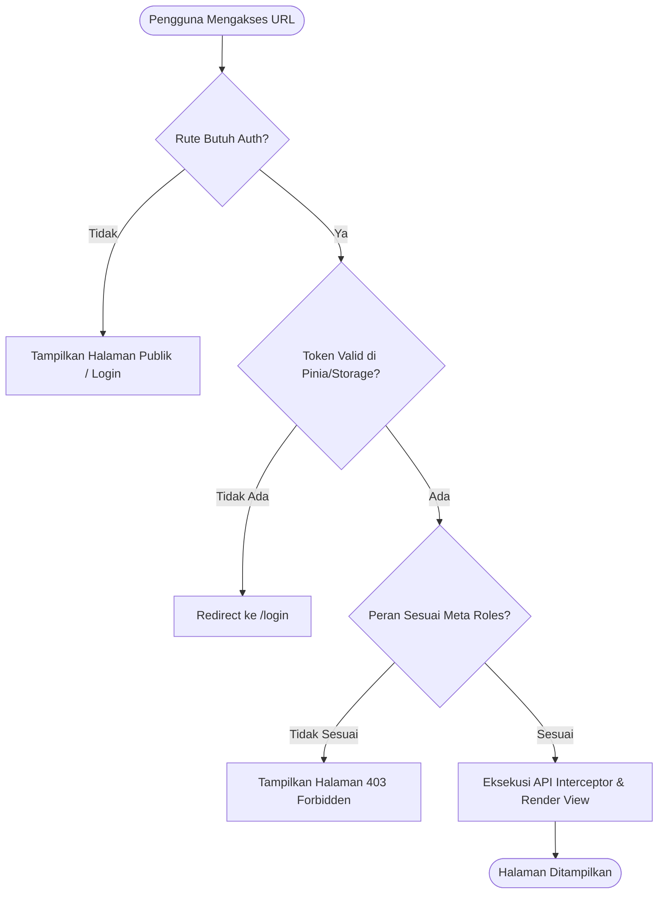

# 01 - Frontend Architecture Specification (Vue 3 Modern)

| Metadata | Keterangan |
| :--- | :--- |
| **Framework** | Vue 3 (Composition API dengan `<script setup>`) |
| **Build Tool & Bundler** | Vite (Fast HMR & Optimized Build) |
| **State Management** | Pinia (Type-safe & Modular Stores) |
| **Routing** | Vue Router 4 (dengan Navigation Guards RBAC) |
| **HTTP Client** | Axios (dengan Request/Response Interceptors terpusat) |
| **Desain & Ikon** | Modern CSS / Utility styling, Lucide Icons |

---

## 1. Prinsip Desain Arsitektur Frontend

1. **Composition API & Single Responsibility**:
   - Komponen dibangun menggunakan sintaks `<script setup>`.
   - Logika bisnis yang dapat digunakan kembali (*reusable logic*) diekstraksi ke dalam **Composables** (`src/composables/`), seperti `useAuth`, `useTasks`, `useApprovals`, dan `useNotification`.

2. **State Management Terdesentralisasi dengan Pinia**:
   - `authStore`: Menyimpan data sesi login pengguna, token, data profil, dan peran pengguna (ADMIN, KADEP, MEMBER).
   - `taskStore`: Menyimpan daftar tugas, filter aktif, pencarian, dan status loading/error.
   - `teamStore`: Menyimpan daftar anggota departemen untuk keperluan *assignee* dan *reporter*.
   - `dashboardStore`: Menyimpan data metrik KPI, distribusi beban kerja tim, dan antrean approval Kadep.

3. **Keamanan Rute & Otorisasi Navigasi (Navigation Guards)**:
   - Setiap rute memiliki metadata hak akses (`meta: { requiresAuth: true, roles: ['HEAD_OF_DEPARTMENT'] }`).
   - Router guard memvalidasi keberadaan token dan kesesuaian peran sebelum komponen dirender.
   - Jika pengguna tidak memiliki wewenang (misal: Member mencoba membuka antrean approval Kadep), halaman akan dialihkan ke rute 403 (*Forbidden*).

4. **Lapisan Layanan API (Centralized API Service Layer)**:
   - Seluruh pemanggilan jaringan dipusatkan pada `src/api/` (misal: `taskApi.js`, `authApi.js`).
   - Axios Interceptor secara otomatis:
     - Menyematkan `Authorization: Bearer <token>` pada setiap outgoing request.
     - Menangkap error `401 Unauthorized` untuk memicu proses refresh token atau logout otomatis.
     - Menangkap error `403 Forbidden` dan menampilkan pemberitahuan otorisasi.

---

## 2. Diagram Alur Navigasi & Otorisasi Rute

